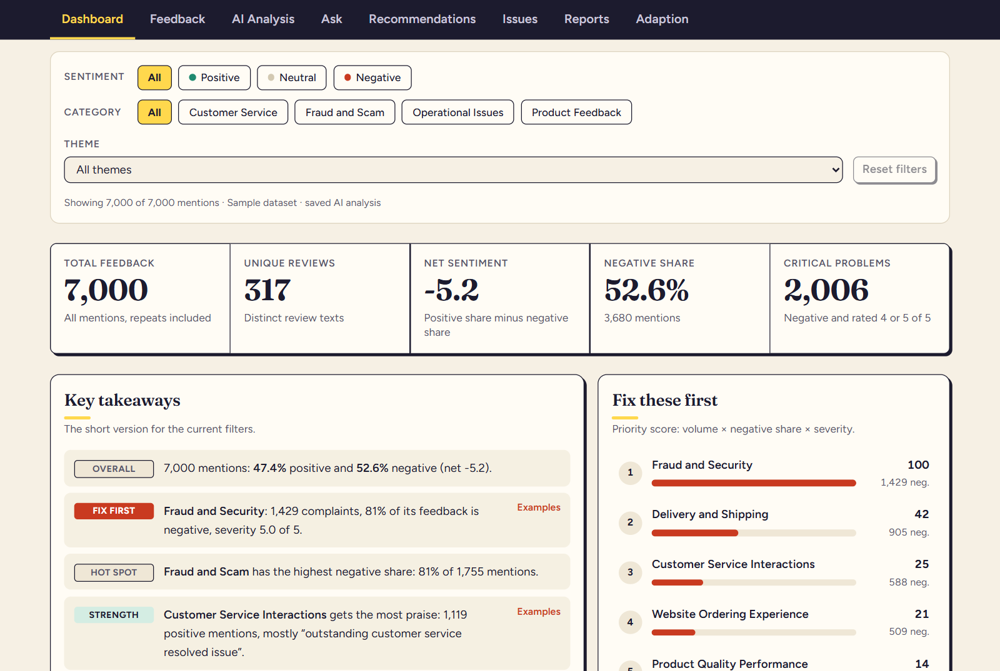
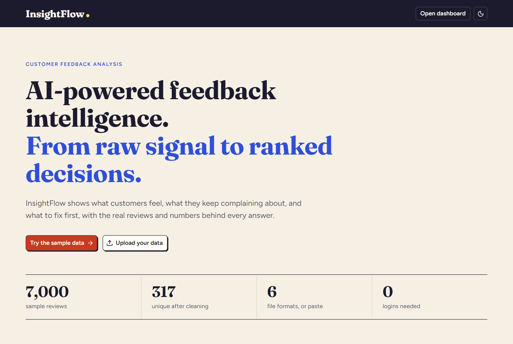
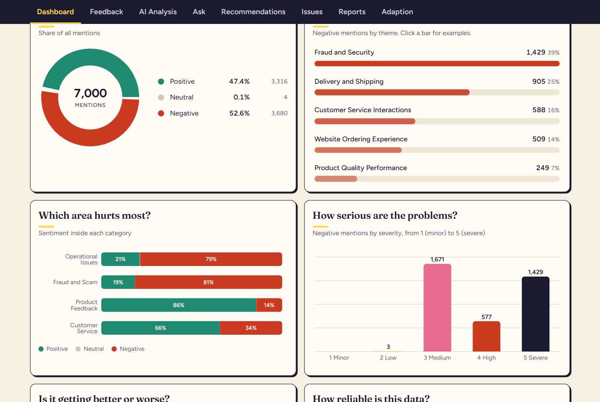
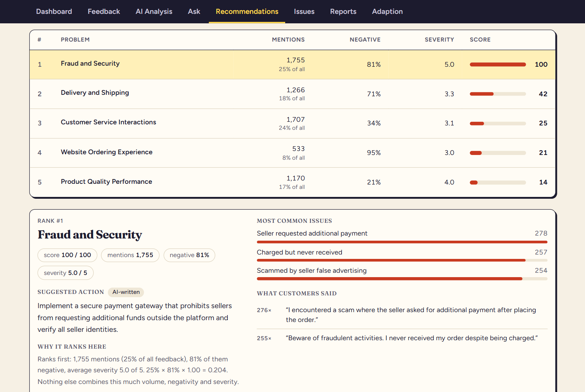
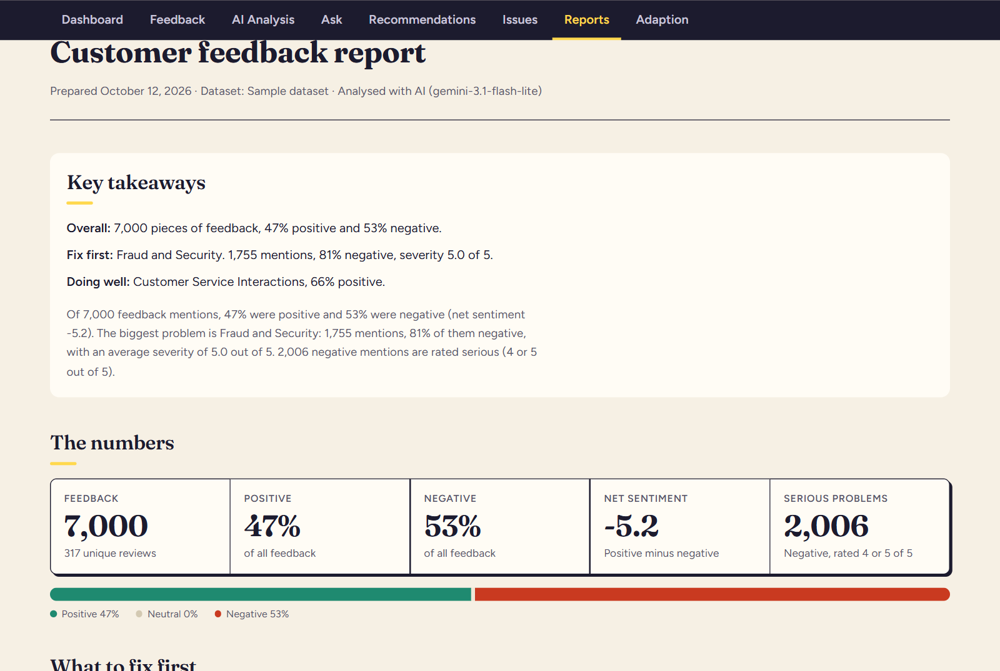
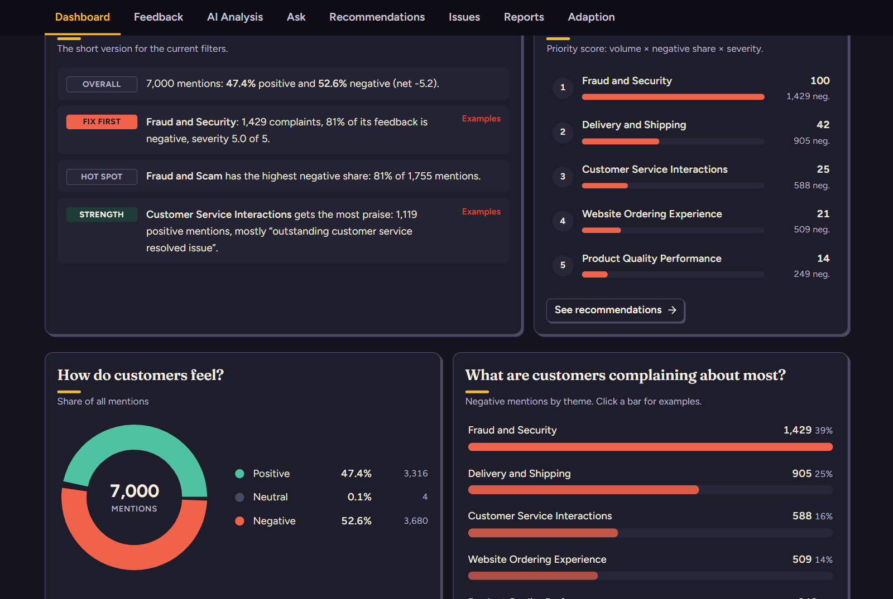

# InsightFlow

**AI-powered feedback intelligence. From raw signal to ranked decisions.**

InsightFlow turns piles of customer feedback into decisions. Import reviews, see what customers feel and talk about, find out what to fix first, track the fixes, and send a report to your team. Ask your own questions in plain English and get answers backed by the real reviews.

It works on first load with a built-in sample (7,000 reviews), needs no login, and runs on a normal laptop.



## How to demo (5 minutes)

1. **Open the app.** The entry page explains the product. Click **Try the sample data**.
2. **Dashboard.** 7,000 reviews collapse into 317 unique ones. Read the **Key takeaways**, then click a row in **Fix these first** to see the real reviews behind it. Click the **Negative** pill or a category: every number and chart updates together.
3. **Recommendations.** The numbered table ranks problems by priority score. Click a row to see the suggested action and **why it ranks here**, with the numbers. Press **Track this issue**.
4. **Issues.** Move the issue to *In progress* and add a note. The card shows whether mentions have gone up or down since it was saved.
5. **Ask.** Try "What do customers say about refunds?". The answer shows how it was worked out and the reviews behind it.
6. **Reports.** Click **Download PDF** or **Copy share link**. The link opens the report without an account.
7. **Adaption.** See the instant data-quality score and the verified Adaption result for the sample.
8. **Your own data.** Click **Upload data** (top right) and drop in a CSV, Excel, JSON or text file, or paste reviews. It becomes a new dataset; the sample stays. Switch between them from the dataset menu.
9. **Theme.** The moon button switches to dark mode.

## Screenshots

| | |
|---|---|
|  |  |
| Entry page | Charts with values written on them |
|  |  |
| Ranked recommendations | Shareable report (prints to PDF) |



## What you can do

| Page | What it does |
|---|---|
| **Feedback** | Browse, search, sort and filter feedback. Upload a file (CSV, TSV, TXT, JSON, JSONL or Excel .xlsx) or paste text, and choose which column is which. Every upload becomes its own dataset, or can be added to the one you have open. Add a single review by hand. |
| **Datasets menu** (top bar) | Keep up to 25 datasets side by side. Each has its own AI analysis, issues, reports and questions. Switch, rename or delete from the menu; uploading never overwrites anything. |
| **AI Analysis** | An AI labels every unique review with sentiment, theme, severity and main issue. Shows the sentiment split, the themes with real quotes, and sentiment inside each category. New feedback is analysed on its own in seconds. |
| **Ask** | Ask a question such as "What do customers say about refunds?" or "Which category has the most problems?". Every answer shows how it was worked out and the reviews behind it. |
| **Dashboard** | Key numbers, key takeaways written from the numbers, the top problems ranked, and charts for sentiment, complaints, categories, severity and trend. One-click filters for sentiment and category (plus theme and date) change everything together. |
| **Recommendations** | A numbered table of problems ranked by priority score with score bars. Click a row for the numbers, a plain-language reason for the rank, an AI-written suggested action and real quotes. |
| **Issues** | Save a problem and track it as open, in progress or resolved, with team notes and a comparison against today's numbers. |
| **Reports** | A business-friendly report with key takeaways. Download it as a PDF or copy a share link that works without an account. |
| **Adaption** | An instant data-quality result computed in your browser, plus a deeper quality check from Adaption on a sample. |

## How the numbers stay trustworthy

- **The AI labels, our code counts.** Every count, percentage and score is calculated by InsightFlow from the AI's labels and is weighted by how many times each review was received. The AI never writes a number.
- **Category is not sentiment.** Categories are never sent to the AI and never used as sentiment. Inside every category there is praise and complaints.
- **Questions are answered in three steps:** the AI turns the question into a search, our code computes the facts, and the AI explains them. Group winners ("which is highest?") are picked by code, and every figure in an answer is checked against the facts.
- **Honest labels.** "Instant" is our own estimate. "Verified by Adaption" is Adaption's result. They use different scales and are never mixed. Nothing is simulated: if there are no dates there is no trend chart.
- **Works when services are down.** Without API keys the AI and Adaption buttons say so clearly, and every saved result and every non-AI page keeps working.

## Getting started

Requires Node.js 20 or newer for the app (the tools in `scripts/` need Node 24). In PowerShell:

```powershell
cd insightflow
npm install
Copy-Item .env.example .env.local
notepad .env.local      # paste your keys, then save
npm run dev
```

Open http://localhost:3000. The sample dataset and a saved analysis of it load automatically, so the app is useful before you add any keys.

### Environment variables

Set these in `.env.local` (locally) or in your host's settings. Keys without the `NEXT_PUBLIC_` prefix are server-only and never reach the browser.

| Name | Needed for | Where to get it |
|---|---|---|
| `GEMINI_API_KEY` | AI analysis, Ask, suggested actions | https://aistudio.google.com/apikey |
| `GEMINI_MODEL` | Which Gemini model to use (we use `gemini-3.1-flash-lite`) | Google AI Studio |
| `ADAPTION_API_KEY` | Adaption data-quality check | Adaption dashboard, Settings, API keys |
| `NEXT_PUBLIC_SUPABASE_URL`, `NEXT_PUBLIC_SUPABASE_ANON_KEY` | Not used. Leave empty (see "Storage") | Supabase |

### Scripts

```powershell
npm run dev        # start the app
npm run build      # production build
npm run lint       # check the code
npm test           # 35 automated checks: calculations, file formats, storage and migration
```

More tools in `scripts/`:

```powershell
node scripts/make-synthetic-csv.ts 1000000 "$env:TEMP\syn-1m.csv" 30000   # fake 1M-row file with a known answer
node scripts/bench-local-engine.ts "$env:TEMP\syn-1m.csv"                  # time the local deduplicator and check it
node scripts/analyse-sample.ts --save                                      # re-run the AI analysis of the sample (app must be running)
node scripts/ask-sample.ts "What do customers like?"                       # try questions from the terminal
```

## How we used Adaption

Adaption is a dataset-improvement platform. We use it for **deduplication and data-quality scoring**, and only the Prompt Deduplication recipe, so wording is never rewritten.

1. The server uploads a small sample and asks Adaption what a run costs (`estimate: true`) before anything is spent. A real run only starts if the user confirms that exact credit amount.
2. We poll until it finishes, then read Adaption's quality evaluation (grade and 0 to 10 score, before and after) and the number of rows it kept.
3. The page shows it as "Verified by Adaption", next to our own instant result.
4. Optional: turn on "Check new uploads automatically" on the Adaption page. After a file import the check then runs in the background, only if the cost is within the credit limit you set. Checking the same data twice reuses the first result, so nothing is spent again.

Why a sample: every Adaption run has a fixed cost of about 11 minutes plus about 0.7 seconds per row, so sending all 7,000 rows would take about 90 minutes. We send each text at most twice, up to 400 rows (a repeatable sample that keeps every category represented). That is about 4 credits and 15 minutes at any file size, and nothing else in the app waits for it. The sample dataset's real result is saved in `data/adaption-sample.json`. See `src/lib/adaption/`.

The instant result (`src/lib/local/`) runs in a Web Worker, so even a million-row file is read, deduplicated and scored in a few seconds without freezing the page.

## Architecture

- **Next.js (App Router) + TypeScript**, Tailwind CSS, shadcn/ui, Recharts. Light and dark mode; colours live in `src/app/globals.css` so charts follow the theme.
- **Browser:** reads files, deduplicates (Web Worker), calculates every metric (`src/lib/analysis/metrics.ts`, `priority.ts`), draws charts, and keeps data in IndexedDB.
- **Server (route handlers in `src/app/api/`):** the only place API keys are used. Each route does one short step (label a batch, estimate a cost, poll a status).
- **AI:** Google Gemini with a response schema, so output is strict JSON that is validated before use.

```
src/app/            pages and API routes
src/components/     screens, charts, shared providers
src/lib/local/      file reading (CSV, TSV, TXT, JSON, JSONL, Excel), dedupe engine and quality score (runs in a worker)
src/lib/storage/    IndexedDB library of datasets, analyses and saved questions
src/lib/adaption/   Adaption client, sampling, types
src/lib/analysis/   AI client, prompts, batching, metrics, priority score
src/lib/ask/        question planning, facts and answer checking
src/lib/report/     report building and share-link encoding
data/               sample dataset and saved real results
scripts/            benchmarks, tests and tools
```

## Storage

Your datasets, their analyses, Adaption results and saved questions are kept in the browser's IndexedDB (`src/lib/storage/`), so there is nothing to set up, nothing is sent to a database, and large files fit (a 100,000-row file takes about 2 MB). Small settings and issues stay in `localStorage`. If the browser blocks storage, the app still works but keeps data only until the page closes, and says so. Data from the older single-dataset version is moved over automatically the first time you open this version. Share links carry the report itself after the `#`, so they need no database either.

**Supabase is not used.** Keeping data in the browser was a deliberate choice for this version: no login, nothing to set up, and customer feedback never leaves the user's computer except the review text sent for AI analysis. A database schema for a shared, multi-user version is drafted in `supabase/migrations/0001_init.sql`, but nothing in the app reads or writes it yet, and the Supabase variables can stay empty.

## Privacy

Uploaded files are read in your browser. Review **text** is sent to Google Gemini for analysis (never categories or dates) and, for the optional quality check, a sample of it to Adaption. Both are shown on screen before you run anything.

## Limits

- The AI analyses up to 2,000 unique reviews at a time (the most repeated first) and says so when it applies.
- Up to 200,000 unique entries are kept per dataset; larger files show a notice. Excel files up to 50 MB and JSON files up to 100 MB are supported (CSV, TSV, TXT and JSONL are read as a stream, so size is not a problem). Old `.xls` files must be re-saved as `.xlsx` or CSV.
- Up to 25 datasets can be kept. Storage is per browser, so clearing site data deletes them.
- The AI's labels are a judgement. For important decisions, read the example reviews shown next to every number.

## Deploying to Vercel

The app is ready to deploy. In PowerShell, from the `insightflow` folder:

```powershell
npx vercel login
npx vercel                                   # first deploy; accept the defaults
npx vercel env add GEMINI_API_KEY production
npx vercel env add GEMINI_MODEL production
npx vercel env add ADAPTION_API_KEY production
npx vercel --prod                            # deploy again so the keys take effect
```

Or push the repository to GitHub, import it at https://vercel.com/new, and add the three environment variables in the project settings. The `data/` folder (sample, saved analysis) is included automatically. AI routes allow up to 60 seconds per call. After deploying, open `/analysis` and `/dashboard`: the saved sample analysis should show without any key.
